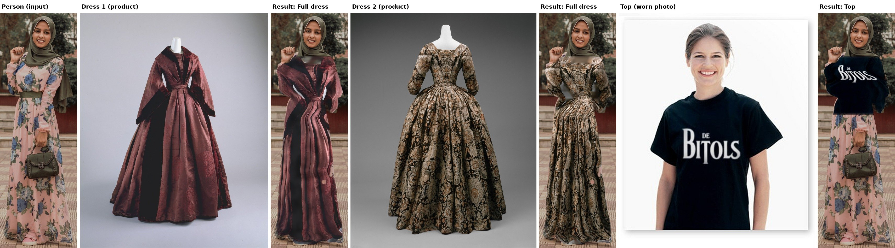

# Dress Up (Android)

Virtual try-on on the phone: **your photo on the left, a dress on the right, tap Try On.** Only the clothes change:
your body shape, pose, face, hair, skin, hands and the background stay exactly as they were.

- Package `com.vanu.dressup`, version 1.0 (versionCode 1), Android 7.0+ (tested target: Android 13+), arm64-v8a / armeabi-v7a APKs (~13 MB)
- Offline after a one-time **114 MB** model download (resumable, every file SHA-256 checked) from the
  [`models-v1` release](https://github.com/vanukrishnans-source/dress-up/releases/tag/models-v1)
  (mirrors: Collage Video's models-v1 release, Google's MediaPipe CDN)

## How to use

1. Install `DressUp-1.0-arm64.apk`, open it, tap **Download** (Wi-Fi recommended).
2. **Your photo** (left): a clear, front-facing photo, full body for dresses.
3. **Dress** (right): a product photo, mannequin photo, flat lay, or a photo of someone wearing it.
4. Pick **Full dress**, **Top** or **Bottom**, then tap **Try On**.
5. Tap the result to flip **before / after**. **Save** (Pictures/DressUp, JPEG q95), **Share**, or **Save before | after**.

## How it works (classical on-device pipeline, no generative model)

1. **Parts + pose** (MediaPipe selfie multiclass segmenter on a letterboxed square, MediaPipe pose landmarker):
   clothes / body skin / face / hair / accessories maps and the shoulder and hip lines, for both photos.
2. **Target** = the person's current clothes region (Full = below the shoulders, Top = above the hips,
   Bottom = below the hips) minus skin, face, hair and accessories. Nothing outside it is ever touched.
3. **Garment cut-out**: worn photo → the wearer's clothes region; product / mannequin photo → the parts model's
   clothes class, intersected with a backdrop-colour test (keeps sleeve gaps open), largest blob, small holes filled.
   For Top / Bottom from a full dress, the garment is split at its narrowest row (the waist).
   The texture is extended past its edges (pull-push) so the warp never samples the backdrop.
4. **Warp**: row-by-row span mapping. Every row of the target maps to the matching relative row of the garment and
   its left..right extent to the garment's left..right extent, so the new garment follows the body outline exactly.
5. **Shading**: the folds and light of the original clothes (fine-blurred luminance / local mean, so the old
   print doesn't carry over) are multiplied onto the new garment, then it is feathered in.
6. **Safety filter** (always on): Falconsai nsfw_image_detection ViT (int8) on both photos and on the result.
   Relaxed (default) blocks above 0.85, Standard above 0.5. There is no off switch. The app only ever replaces
   clothes with the picked garment; it cannot remove clothes.

## Limits (honest)

- It's a 2-D warp, not a generative try-on: it doesn't invent new shape. A long gown on someone wearing jeans
  is painted on the jeans' outline (legs stay separate); a short dress on someone in a long dress is stretched to
  the long dress's length. Sleeves follow the person's current sleeves.
- Best with front-facing, upright poses. Side poses, sitting, crossed arms give weaker results.
- Patterns and text are stretched to fit (they don't follow 3-D folds); logos can look warped.
- Bags, hands or arms held in front of the clothes can be painted over when the parts model misses them.
- Head scarves are kept above the shoulders; the part draped over the chest is treated as clothing.
- Works on photos up to 2048 px on the long side (bigger photos are scaled down to that).

## Models

| File | Size | Use | Licence |
|---|---|---|---|
| selfie_multiclass_256x256.tflite | 16.4 MB | clothes / skin / hair parts | Apache-2.0 (Google MediaPipe) |
| pose_landmarker_full.task | 9.4 MB | shoulders / hips | Apache-2.0 (Google MediaPipe) |
| nsfw_vit_int8.onnx | 88.6 MB | safety filter | Apache-2.0 (Falconsai/nsfw_image_detection, int8) |

## Build

`./gradlew :app:assembleRelease` (JDK 17, Android SDK 35; signing from `keystore.properties`).
`reference/parse_photo.py` + `TrialRunner` run the same try-on code on a desktop for the trial.

## Trial

Inputs (all CC0 / public domain, Wikimedia Commons): "Woman pink and blue dress (crop full body)",
The Met "Dress MET DT3719" and "Dress MET DT11835", "CU 390 KEN t-shirt".
